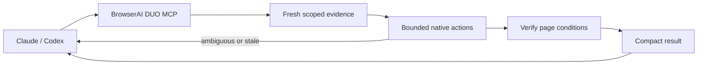

<p align="center"></p>

<h1 align="center">BrowserAI DUO</h1>
<p align="center"><strong>One agent workspace for browser work today, with desktop control in development.</strong></p>

<p align="center">
  <a href="docs/browserrad/PROJECT.md"><strong>Project diary</strong></a> ·
  <a href="docs/browserrad/BENCHMARKS.md"><strong>Measurements</strong></a> ·
  <a href="docs/browserrad/DEVELOPMENT.md"><strong>Build & contribute</strong></a> ·
  <a href="README.Neo.md"><strong>Upstream Neo</strong></a>
</p>
<p align="center">
  
  
  
</p>

## A browser that respects the cost of every turn

**BrowserAI DUO is the new name for the BrowserRAD fork of BrowserOS Neo.** Browser automation works today through Claude, Codex, and other MCP clients. Desktop automation is the next development track and is not available in the published alpha. The goal is faster, independently verified tasks with the same or fewer main-agent tokens and no hidden cost increase from passing work to another model.

We start close to the browser: remove avoidable animation waits, ask several questions of one fresh capture, execute bounded actions, and reuse procedures only while their targets and outcomes still hold.

The cockpit's **Wave Runner palette** uses warm cream and graphite with sea-glass teal controls and a restrained orange accent, drawing from the approved OG Wave and Deep Teal colors used in AngeloDeLeon.com artwork. Light and dark modes share the same visual identity. The tattoo-style banner remains an illustrated concept.

> **Local preview, no BrowserAI DUO release yet.** The published Apple Silicon alpha still installs as **BrowserRAD**. A BrowserAI DUO app was built, ad-hoc signed, smoke-tested and installed locally on November 16, 2026; the final cockpit resource update was repacked into that tested Chromium binary. This local install is not a downloadable release or notarized build. The banner is concept art: desktop, vault, and remote features shown there are not release claims.

[**Previous BrowserRAD 0.0.1-alpha.2 release for Apple Silicon macOS →**](https://github.com/RaDeleon/BrowserOS/releases/tag/v0.0.1-alpha.2) · [Release notes and remaining checks](docs/browserrad/release-notes/v0.0.1-alpha.2.md). Its ZIP contains `BrowserRAD.app`.

## What is taking shape

| Technique | BrowserAI DUO approach | State |
| :--- | :--- | :--- |
| Fast local input | Instant pointer feedback; native hit checks remain | Implemented in source |
| Less response overhead | Retention cleanup leaves the journal response path; append remains awaited | Implemented in source |
| Smaller observations | Several literal queries share one fresh capture; scoped content reads | Implemented in source |
| Fewer planner turns | Bounded plans resolve fresh, unique targets and check postconditions | Implemented in source |
| Deterministic reuse | Existing saved flows plus reusable plans; stop on stale or uncertain actions | Native mechanisms retained; fork validation ongoing |
| Selective vision | DOM first; return unresolved evidence to the planner; no mandatory vision pass | No new provider dependency |
| Direct retrieval | Opt-in same-origin GET in the existing browser context | Experimental; no cookie export |
| Site-provided tools | Opt-in current WebMCP discovery/invocation with origin checks | Experimental; browser/site support required |
| Separate installation | Distinct from upstream Neo; legacy BrowserRAD profile and secrets remain compatible | Local macOS preview installed and verified; public release pending |
| Desktop control | Planned opt-in local desktop surface | Not in the published alpha |

Implementation and rollout details live in the [development guide](docs/browserrad/DEVELOPMENT.md). A feature in source is not a claim that an installed build has passed live acceptance.

## The shortest useful loop



No extra planner is required for the deterministic path. When evidence is incomplete, the caller gets a clear stop instead of an optimistic success or an automatic repeat of a possibly completed write.

```js
// BrowserAI DUO's run SDK: three questions, one fresh content read.
const page = await browser.open('https://example.com/catalog');
return await page.evidence({
  over: 'content',
  selector: 'main',
  queries: ['Availability', 'Price', 'Delivery'],
});
```

## The scoreboard starts with evidence

The first synthetic workload uses stock Neo **0.52.1.1**, in a background tab, with five warmed repetitions. Each performs a snapshot, scoped read, field fill, click, and verified readback.

| Metric | Stock Neo baseline | BrowserAI DUO |
| :--- | ---: | :--- |
| Successful fixture runs | 5 / 5 | Pending matched native run |
| Median browser execution | 392 ms | Pending |
| Observed maximum, five runs | 412 ms | Pending |
| Client-reported task tokens | Unknown | Unknown |
| Total task cost | Unknown | Unknown |

These are **browser-execution measurements**, not submission-to-completion agent latency. Five samples are not a reliable tail estimate. [Read the protocol and raw samples →](docs/browserrad/BENCHMARKS.md)

A separate shared-evidence prototype reduced the median for three fixture queries from **11 ms to 3 ms** across ten paired warmed repetitions. It ran inside stock Neo, not a native BrowserAI DUO build; token savings remain unmeasured. [Experiment details](docs/browserrad/BENCHMARKS.md#shared-evidence-prototype--november-2-2026).

## Work on BrowserAI DUO

Start with [AGENTS.md](AGENTS.md) for shared rules, [CLAUDE.md](CLAUDE.md) for Claude entry instructions, and the [development guide](docs/browserrad/DEVELOPMENT.md) for toolchain and build boundaries. The [project diary](docs/browserrad/PROJECT.md) records decisions, evidence, and the next gates.

The repository keeps upstream internal package names and the `browserclaw` build selector to make future upstream merges easier. **BrowserAI DUO** is the fork's product identity. Pulling an upstream update and shipping it are separate decisions.

## Standing on good work

Built on [BrowserOS](https://github.com/browseros-ai/BrowserOS) and Chromium. The [original Neo README](README.Neo.md), [license](LICENSE), and upstream notices remain in the repository. This fork is independent and is not an official BrowserOS release.

Technique research draws on [Stagehand](https://docs.stagehand.dev/v4/best-practices/speed-optimization), [Browser Use](https://docs.browser-use.com/open-source/customize/agent/all-parameters), [Skyvern](https://www.skyvern.com/docs/developers/browser-automation), [Browserless](https://docs.browserless.io/baas/best-practices), and [agent-browser](https://agent-browser.dev/snapshots). The [ten-product landscape review](docs/browserrad/BROWSER-AGENT-LANDSCAPE-2026-11-08.md) lists ideas for later evaluation; its published performance numbers are not BrowserAI DUO benchmarks. No competing agent stack is required.

README composition was inspired by [Dify](https://github.com/langgenius/dify), [Browser Use](https://github.com/browser-use/browser-use), [Supabase](https://github.com/supabase/supabase), and [Ollama](https://github.com/ollama/ollama). The BrowserAI DUO artwork and wording are original.
