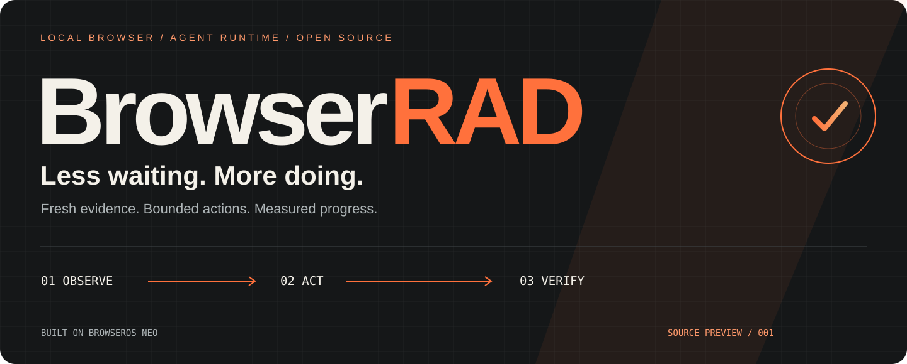
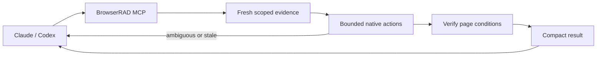

<p align="center"></p>

<p align="center">
  <a href="docs/browserrad/PROJECT.md"><strong>Project diary</strong></a> ·
  <a href="docs/browserrad/BENCHMARKS.md"><strong>Measurements</strong></a> ·
  <a href="docs/browserrad/DEVELOPMENT.md"><strong>Build & contribute</strong></a> ·
  <a href="README.Neo.md"><strong>Upstream Neo</strong></a>
</p>
<p align="center">
  
  
  
</p>

## A browser that respects the cost of every turn

**BrowserRAD is an independent BrowserOS Neo fork for Claude, Codex, and other MCP clients.** Its goal is faster, independently verified tasks with the same or fewer main-agent tokens—and no hidden cost increase from passing the work to another model.

We start close to the browser: remove avoidable animation waits, ask several questions of one fresh capture, execute bounded actions, and reuse procedures only while their targets and outcomes still hold.

> **Source preview.** BrowserRAD is under development. The installed Neo remains the working comparison. A BrowserRAD installer and an end-to-end speed/token claim are not available yet.

First release in preparation: **0.0.1-alpha.1**, for Apple Silicon macOS. See the [alpha release notes and remaining gates](docs/browserrad/release-notes/v0.0.1-alpha.1.md).

## What is taking shape

| Technique | BrowserRAD approach | State |
| :--- | :--- | :--- |
| Fast local input | Instant pointer feedback; native hit checks remain | Implemented in source |
| Less response overhead | Retention cleanup leaves the journal response path; append remains awaited | Implemented in source |
| Smaller observations | Several literal queries share one fresh capture; scoped content reads | Implemented in source |
| Fewer planner turns | Bounded plans resolve fresh, unique targets and check postconditions | Implemented in source |
| Deterministic reuse | Existing saved flows plus reusable plans; stop on stale or uncertain actions | Native mechanisms retained; fork validation ongoing |
| Selective vision | DOM first; return unresolved evidence to the planner; no mandatory vision pass | No new provider dependency |
| Direct retrieval | Opt-in same-origin GET in the existing browser context | Experimental; no cookie export |
| Site-provided tools | Opt-in current WebMCP discovery/invocation with origin checks | Experimental; browser/site support required |
| Separate installation | BrowserRAD app, bundle ID, profile, state, MCP names | Source wired; native packaging verification pending |

Implementation and rollout details live in the [development guide](docs/browserrad/DEVELOPMENT.md). A feature in source is not a claim that an installed build has passed live acceptance.

## The shortest useful loop



No extra planner is required for the deterministic path. When evidence is incomplete, the caller gets a clear stop instead of an optimistic success or an automatic repeat of a possibly completed write.

```js
// BrowserRAD's run SDK: three questions, one fresh content read.
const page = await browser.open('https://example.com/catalog');
return await page.evidence({
  over: 'content',
  selector: 'main',
  queries: ['Availability', 'Price', 'Delivery'],
});
```

## The scoreboard starts with evidence

The first synthetic workload uses stock Neo **0.52.1.1**, in a background tab, with five warmed repetitions. Each performs a snapshot, scoped read, field fill, click, and verified readback.

| Metric | Stock Neo baseline | BrowserRAD |
| :--- | ---: | :--- |
| Successful fixture runs | 5 / 5 | Pending matched native run |
| Median browser execution | 392 ms | Pending |
| Observed maximum, five runs | 412 ms | Pending |
| Client-reported task tokens | Unknown | Unknown |
| Total task cost | Unknown | Unknown |

These are **browser-execution measurements**, not submission-to-completion agent latency. Five samples are not a reliable tail estimate. [Read the protocol and raw samples →](docs/browserrad/BENCHMARKS.md)

A separate shared-evidence prototype reduced the median for three fixture queries from **11 ms to 3 ms** across ten paired warmed repetitions. It ran inside stock Neo, not a native BrowserRAD build; token savings remain unmeasured. [Experiment details](docs/browserrad/BENCHMARKS.md#shared-evidence-prototype--november-2-2026).

## Work on BrowserRAD

Start with [AGENTS.md](AGENTS.md) for shared rules, [CLAUDE.md](CLAUDE.md) for Claude entry instructions, and the [development guide](docs/browserrad/DEVELOPMENT.md) for toolchain and build boundaries. The [project diary](docs/browserrad/PROJECT.md) records decisions, evidence, and the next gates.

The repository keeps upstream internal package names and the `browserclaw` build selector to make future upstream merges easier. **BrowserRAD** is the fork's product identity. Pulling an upstream update and shipping it are separate decisions.

## Standing on good work

Built on [BrowserOS](https://github.com/browseros-ai/BrowserOS) and Chromium. The [original Neo README](README.Neo.md), [license](LICENSE), and upstream notices remain in the repository. This fork is independent and is not an official BrowserOS release.

Technique research draws on [Stagehand](https://docs.stagehand.dev/v4/best-practices/speed-optimization), [Browser Use](https://docs.browser-use.com/open-source/customize/agent/all-parameters), [Skyvern](https://www.skyvern.com/docs/developers/browser-automation), [Browserless](https://docs.browserless.io/baas/best-practices), and [agent-browser](https://agent-browser.dev/snapshots). Their published performance numbers are not BrowserRAD benchmarks. No competing agent stack is required.

README composition was inspired by [Dify](https://github.com/langgenius/dify), [Browser Use](https://github.com/browser-use/browser-use), [Supabase](https://github.com/supabase/supabase), and [Ollama](https://github.com/ollama/ollama). The BrowserRAD artwork and wording are original.
